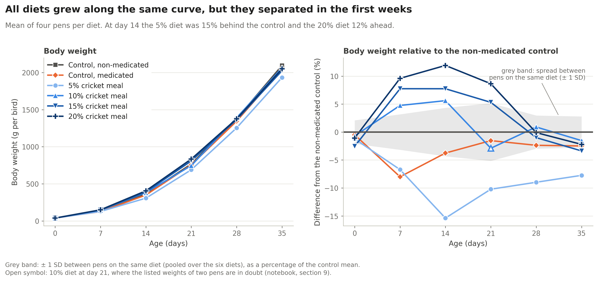
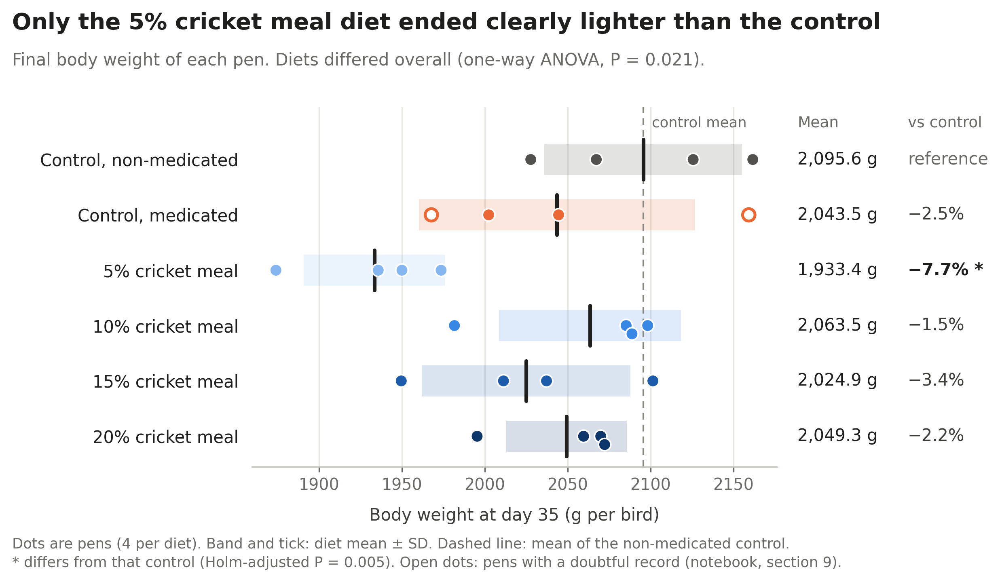
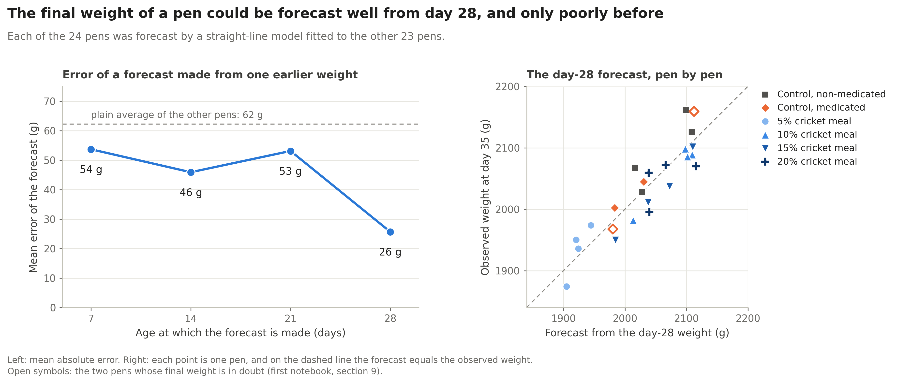

# Broiler Growth and Feed Efficiency with Dietary Cricket Meal

Cricket meal is being tested as a protein source for broilers. This project takes the open data of a 35-day trial with cricket meal at 0 to 20% of the diet and looks at growth, feed efficiency, organs and breast meat. Most of the work went into turning a spreadsheet made for people into data that can be analysed, and checking it along the way.

## Dataset

- Ross 308 broilers: 624 birds in 24 pens (26 per pen) according to the dataset description
- Six diets, four pens each: non-medicated control (0% NM), medicated control (0% M), and 5, 10, 15 and 20% cricket meal (CM)
- Body weight and feed intake recorded weekly from day 0 to day 35
- Three birds per pen sampled for organs on days 13, 20 and 35, for gut lesions on days 20 and 35, and for breast meat on day 35
- Source: Mendeley Data, [doi:10.17632/rj5fybnzh6.1](https://doi.org/10.17632/rj5fybnzh6.1)

The workbook holds one mean per pen per weighing, and single records only for the sampled birds. It has no bird counts. Its numbers point to 27 birds in ten of the pens.

## Question

How did dietary cricket-meal inclusion influence broiler growth and feed efficiency?

## Notebooks

| Notebook | Content |
|---|---|
| `01_growth_feed_efficiency.ipynb` | Growth sheet: audit, cleaning, body weight, gain, feed intake, feed conversion |
| `02_organs_meat_quality.ipynb` | The other five sheets: organ weights, lesion scores, breast yield, colour, cooking loss, texture |
| `03_prediction_models.ipynb` | Simple models that forecast final pen weight and predict breast weight |

## What I did

I inspected each sheet before changing anything. Cleaning was limited to what the inspection showed to be wrong: stray spaces in labels, a full stop as the missing-value mark, text in number cells, and pen numbers that had turned into decimals. No rows were deleted. Four values were set aside, each for a stated reason. Other doubtful values were flagged and kept.

Every calculation supplied in the workbook was done again and compared: gain, feed conversion ratio (FCR), organ indices and yields. Diets were compared on pen values (four per diet), because the pen is the experimental unit. Each diet was compared with the non-medicated control. For prediction I used simple models and tested each one on pens it had not seen.

## Main findings

| Diet | Final body weight (g) | Feed intake, 35 days (g/bird) | FCR |
|---|---|---|---|
| 0% NM | 2095.6 ± 59.6 | 3265.5 ± 186.0 | 1.588 ± 0.078 |
| 0% M | 2043.5 ± 83.3 | 3164.7 ± 181.7 | 1.582 ± 0.128 |
| 5% CM | 1933.4 ± 42.5 | 2968.4 ± 161.1 | 1.567 ± 0.070 |
| 10% CM | 2063.5 ± 54.8 | 3185.3 ± 119.0 | 1.574 ± 0.062 |
| 15% CM | 2024.9 ± 62.9 | 2986.7 ± 183.3 | 1.503 ± 0.052 |
| 20% CM | 2049.3 ± 36.4 | 3040.3 ± 181.2 | 1.513 ± 0.098 |

Mean ± SD of four pens.

**Growth and feed efficiency**

- All diets grew along the same curve to about 2 kg at day 35.
- Final body weight differed among diets (P = 0.021). Only the 5% CM pens differed from the control: 7.7% lighter (adjusted P = 0.005).
- At day 14 the 5% CM birds were 15% lighter than the control and the 20% CM birds 12% heavier (adjusted P < 0.01 for both).
- Neither feed intake (P = 0.13) nor FCR (P = 0.59) differed clearly among diets. The 5% CM pens ate 9.1% less than the control.

**Organs, gut lesions and breast meat**

- Some organ indices (organ weight as a percentage of body weight) differed between diets on days 13 and 20. None did at day 35.
- At day 20 the 5% CM diet had the highest small-intestine index (7.9% against 7.1%). The intestines were not heavier. The birds were lighter.
- Breast yield was lowest with 5% CM (16.8% of live weight against 19.1%, P = 0.049). Cooking loss was higher with 5 and 10% CM (P = 0.016). Texture and colour showed no differences.
- Gut lesions rose from 12.5% of birds at day 20 to 58.3% at day 35. The evidence for a diet effect at day 35 is borderline (P = 0.055).

**Prediction**

- A straight line on the day-28 weight forecast the final weight of an unseen pen with a mean error of 26 g (1.3%). Earlier weights were of little use.
- Live weight and sex predicted breast weight with a mean error of 27 g. The predictions explained 81% of the variation between birds (R2 = 0.81). A random forest did worse than a straight line in both tasks.

**Data checks**

- The sheet's gain column disagrees with its weight column in 14 of 120 pen-weeks, and 21 supplied organ indices do not match the listed weights. The notebooks show each case and what it changes.

With four pens per diet, only large differences can be detected.

## Figures

The other seven figures are in `figures/`.

## Tools

Python, pandas, NumPy, matplotlib, SciPy, scikit-learn and openpyxl.

## Data source

Collins, S. (2022). *The effects of cricket meal (Gryllus sigillatus) on the meat quality, growth, and internal morphology of broiler chickens* [Dataset]. Mendeley Data, V1. https://doi.org/10.17632/rj5fybnzh6.1 (CC BY 4.0).

Related article, with the same title: Fisher, H. J., Empey, M., MacIsaac, J. L., Rathgeber, B. R., Mason, B., Colombo, S. M., & Collins, S. A. (2024). *Canadian Journal of Animal Science*, 104(3), 285-300. https://doi.org/10.1139/cjas-2023-0105

The workbook is not included in this repository. `data/README.md` explains where to get it.

## Reproducibility

The notebooks are written for Google Colab. Each one runs on its own: open it, run all cells and upload the workbook when asked. Results are the same on every run, because the steps that use random numbers start from a fixed seed. Minimum package versions are in `requirements.txt`.
